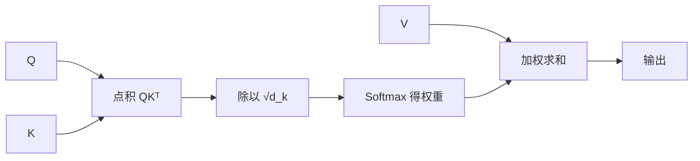
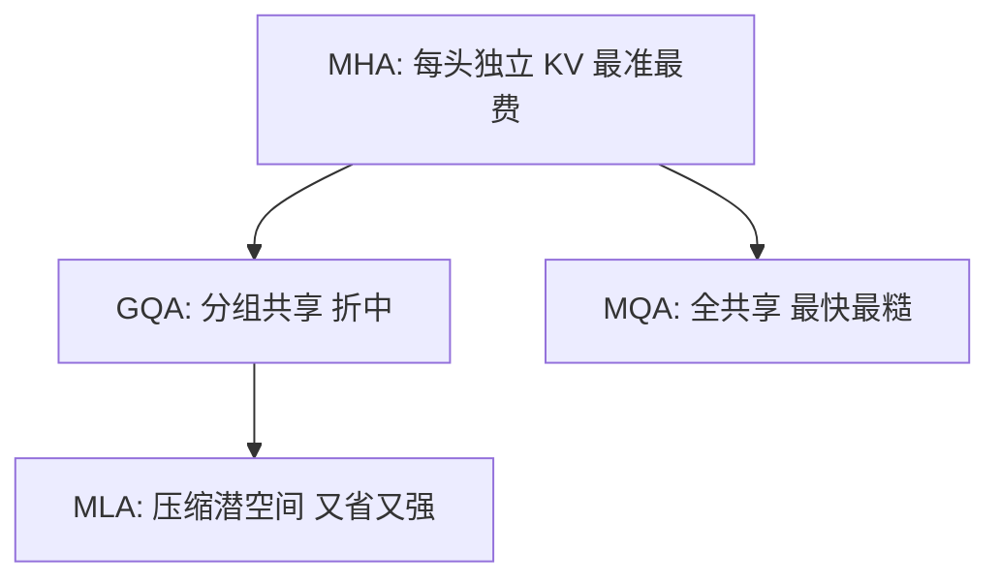

# 注意力机制：模型怎么知道该关注谁？

> **一句话：** 拿 Q 和所有 K 打分、softmax 成权重、加权取 V——一个可微分的「软检索」；KV 缓存与 GQA / MLA 变体，决定推理时花多少显存。

> 这是 Transformer 的「发动机」，也是理解一切大模型的关键零件。上一篇 [Transformer 架构](/knowledge/transformer) 把它当黑盒用，这篇拆开看：Q/K/V 是什么、公式怎么来的、推理时怎么省显存、各家怎么魔改。

## 用比喻先建立直觉

想象你在读一句话，看到「它」这个词，你脑子里会自动问：「它指的是前面哪个人 / 哪件事？」——**你给前面的每个词分配了不同的「注意力权重」**。

注意力机制就是让模型做同样的事：对当前要处理的字，去和序列里所有字「打分」，分高的多关注，分低的少关注。

- **Q（Query，查询）**：「我现在这个字，想找什么信息？」——相当于你手里的问题。
- **K（Key，键）**：「我这个字，能提供什么信息？」——相当于每个候选的「标签」。
- **V（Value，值）**：「我这个字，实际携带的内容」——匹配上了，就把内容按权重取走。

::: tip 类比检索系统
Q 是搜索词，K 是每份文档的标题，V 是文档正文。你拿搜索词和所有标题比对（算相似度），按匹配度高低，把对应正文「加权混合」成最终答案。注意力本质就是**一个可微分的软检索**。
:::

---

## 缩放点积注意力（核心公式）

对一组 Q、K、V，注意力输出是：

$$\text{Attention}(Q,K,V) = \text{softmax}\left(\frac{QK^\top}{\sqrt{d_k}}\right)V$$

拆开看每一步：

1. **算相似度**：$QK^\top$ 让每个 Query 和每个 Key 做点积，值越大表示越相关。
2. **缩放**：除以 $\sqrt{d_k}$（$d_k$ 是向量维度）。不缩放的话，维度一大点积数值会很大，softmax 一算就「两极分化」、梯度消失。这是工程上的稳定技巧。
3. **softmax**：把分数变成 0~1 的权重，且总和为 1（谁该被重点关注）。
4. **加权求和**：用这些权重去乘 V，得到融合了全局信息的输出。

---

## 多头注意力（Multi-Head）

单个注意力只能捕捉「一种关系视角」。多头就是并行跑 h 组独立的 Q/K/V，每组在不同的子空间里找关系（有的看语法、有的看指代、有的看语义），最后把 h 个结果拼起来再过一层线性变换。

$$\text{MultiHead}(Q,K,V) = \text{Concat}(\text{head}_1,...,\text{head}_h)W^O$$

直觉：**一个专家不够，叫一个专家组各看各的，再汇总**。大模型里常见的头数是 32、40、64 等。

---

## KV 缓存：推理时为什么能「续写」

生成文字是一字一字来的。第 100 个字时，理论上要重新算前 99 个字和自己的关系——很浪费。于是推理时把前面算过的 K 和 V **缓存（cache）**下来，后面直接用，只算新字的 Q。

::: warning KV 缓存的代价
缓存大小和「序列长度 × 层数 × 头数 × 隐藏维度」成正比。聊得越久、模型越大，显存占用越夸张——这正是各种注意力变体要解决的痛点（见下文）。
:::

---

## 主流变体（各家省的「显存招数」）

这是 2024–2025 年架构竞争最激烈的地方，也是 [模型架构](/architecture/) 栏目会展开的主题。先给速览：

- **MHA（多头注意力，原始版）**：每个头都有自己独立的 K、V。最准但最费缓存。
- **MQA（多查询注意力）**：所有头**共享同一份 K、V**。缓存直接砍到 1/h，推理快但表达力略降。PaLM、Falcon 用过。
- **GQA（分组查询注意力）**：折中——把头分成 g 组，每组共享一份 K、V。又快又不太掉点，**Llama、Qwen3、Gemma 等主流开源模型都在用**，是当下的「性价比之王」。
- **MLA（多头潜在注意力，DeepSeek 独门）**：把 K、V **压缩到低维潜空间**再存，用的时候再展开。缓存比 GQA 还小，且实测效果不输甚至更好。DeepSeek V3/R1 凭它把成本压到极低，已被 Kimi、Mistral 等「抄作业」。

::: info 为什么这事重要
同样一个模型，注意力变体能决定「跑一次要几张卡、花多少钱」。对想落地 AI 产品的人来说，理解 GQA / MLA 比背架构细节更实用——这部分在 [推理优化](/inference-optimization/) 会继续展开。
:::

---

## 位置编码：让模型知道「你排第几」

前面说过，注意力本身不分前后，得额外注入位置信息。两大路线：

- **绝对 / 正弦编码**：给第 i 个位置一个固定向量。简单，但难外推到比训练时更长的句子。
- **RoPE（旋转位置编码）**：把位置信息「旋转」进 Q、K 的向量里——两个字的相对位置差，会直接体现在它们旋转角度的差上。对长文本外推友好，**GPT、Llama、DeepSeek、Qwen 等几乎全用 RoPE**。

::: tip 一句话记住 RoPE
它让「相对位置」天然地编码进注意力打分里，所以模型既能懂「猫吃鱼」和「鱼吃猫」的区别，又能较从容地处理比训练时更长的输入。
:::

---

## 下一步学什么

- 理解了注意力，你已经握住了大模型的核心。看 [预训练与后训练](/knowledge/training)：模型怎么用这些零件「从零训起来」。
- 想横向比较各家怎么用这些变体：本博客 [模型架构](/architecture/) 栏目（DeepSeek / Llama / Qwen 等逐家拆解）。

<!-- kb-related:start -->
## 相关笔记

- [DeepSeek](/base-models/deepseek) — 标签：MLA、交叉引用
- [模型架构总览](/architecture/) — 标签：RoPE、交叉引用
- [推理优化总览](/inference-optimization/) — 标签：KV缓存、交叉引用
- [大语言模型概览](/knowledge/llms) — 交叉引用
- [预训练与后训练](/knowledge/training) — 交叉引用

<!-- kb-related:end -->

<!-- kb-backlinks:start -->
## 被以下笔记引用

- [大语言模型概览](/knowledge/llms)
- [预训练与后训练](/knowledge/training)
- [Transformer 架构](/knowledge/transformer)
- [DeepSeek](/base-models/deepseek)
- [模型架构总览](/architecture/)
- [推理优化总览](/inference-optimization/)

<!-- kb-backlinks:end -->

## 延伸阅读

- 原论文《Attention Is All You Need》（[arXiv:1706.03762](https://arxiv.org/abs/1706.03762)）
- Jay Alammar《The Illustrated Transformer》（[jalammar.github.io](https://jalammar.github.io/illustrated-transformer/)）
- Sebastian Raschka《The Big LLM Architecture Comparison》（架构变体权威综述，[magazine.sebastianraschka.com](https://magazine.sebastianraschka.com/p/the-big-llm-architecture-comparison)）
