# 知识库总览 · 一张地图走完全库

> 这里是我把全网权威学习资源「嚼碎消化」后沉淀下来的**个人知识库**。整套库按三层组织——**层级为干、链接为脉、地图为门**：这一页就是「门」，你从这扇门进去，永远不会迷路。

::: info 这套库的三层结构
- **地图层（你在这里）**：总览、图谱、缺口、别名表——回答「从哪进、先学什么、去哪找」。
- **主题层**：四大领域（地基 / 核心骨架 / 训练 / 模型与应用）——回答「学哪块」。
- **原子笔记层**：一个概念一篇，标题即问题，顶部一句话答案——回答「学多深」。
:::

---

## 四大领域（主题层）

每个领域卡片下面挂着它的原子笔记，点标题直接进。笔记页顶部都有一句话答案，30 秒就能判断「是不是我要找的那篇」。

### ① 地基 —— 机器怎么学

- **[机器学习基础](/knowledge/ml-basics)**：给数据和目标，让机器自己总结规则；监督 / 无监督 / 强化三大范式。
- **[神经网络与反向传播](/knowledge/neural-networks)**：神经元怎么堆叠出表达力，误差怎么用链式法则分摊到每个参数。

### ② 核心骨架 —— 模型长什么样

- **[Transformer 架构](/knowledge/transformer)**：自注意力让所有字同时互相看，编码器 + 解码器堆叠成统一骨架。
- **[注意力机制](/knowledge/attention)**：Q/K/V 打分的软检索；KV 缓存与 GQA / MLA 变体决定推理成本。

### ③ 训练 —— 模型怎么造出来

- **[预训练与后训练](/knowledge/training)**：先海量自学出「博学但没规矩」的基础模型，再 SFT → RLHF / DPO → RLVR 调教成品。深入阅读见 [后训练专题](/post-training/)。

### ④ 模型与应用 —— 智能怎么用起来

- **[大语言模型概览](/knowledge/llms)**：分词、向量化、Transformer 堆叠、自回归循环——一条链路全景。
- **[推理模型](/knowledge/reasoning)**：会打草稿的 AI 怎么炼成，思考开关与努力控制怎么用。

> 专题纵深（模型横评 / Agent / 推理优化 / 评测等）在顶部导航的对应栏目，它们和上面的核心笔记在 [知识图谱](/knowledge/graph) 里是连通的。

---

## 先修路线图

```mermaid
graph TD
    subgraph S1["① 地基 · 机器怎么学"]
        A[机器学习基础]
        B[神经网络与反向传播]
    end
    subgraph S2["② 核心骨架 · 模型长什么样"]
        C[Transformer 架构]
        D[注意力机制]
    end
    subgraph S3["③ 训练 · 模型怎么造出来"]
        E[预训练与后训练]
    end
    subgraph S4["④ 模型与应用 · 智能怎么用起来"]
        F[大语言模型概览]
        G[推理模型]
        H[Agent 智能体]
    end

    A --> B
    B --> C
    C --> D
    A --> E
    D --> E
    E --> F
    F --> G
    F --> H
    C --> H

    classDef base fill:#0e1a36,stroke:#22d3ee,stroke-width:2px,color:#cffafe
    classDef core fill:#12203f,stroke:#38bdf8,stroke-width:2px,color:#e0f2fe
    classDef train fill:#1e1b4b,stroke:#818cf8,stroke-width:2px,color:#e0e7ff
    classDef app fill:#134e4a,stroke:#2dd4bf,stroke-width:2px,color:#ccfbf1

    class A,B base
    class C,D core
    class E train
    class F,G,H app

    style S1 fill:#0b1020,stroke:#22d3ee,stroke-dasharray:6 4
    style S2 fill:#0b1020,stroke:#38bdf8,stroke-dasharray:6 4
    style S3 fill:#0b1020,stroke:#818cf8,stroke-dasharray:6 4
    style S4 fill:#0b1020,stroke:#2dd4bf,stroke-dasharray:6 4
```

> 箭头表示「建议的先修顺序」。不先搞懂神经网络，直接啃 Transformer 会很吃力。想按阶段系统学（带验收标准），看 [我的进阶路线](/roadmap)。

---

## 五入口查找法（找一篇笔记，从来不止一条路）

每篇笔记都至少有五个入口，想到哪个用哪个——**入口越多，回忆线索也越多**：

1. **分类树**：左侧边栏按领域分组，逐层点进去；
2. **标签**：每篇笔记 frontmatter 的 `tags`，在 [图谱页的标签索引](/knowledge/graph) 按概念簇浏览；
3. **搜索**：右上角搜索框，支持口语词——记不全标题就先查 [概念别名表](/knowledge/aliases)；
4. **学习路线**：按 [进阶路线](/roadmap) 的顺序推进，每一步该看哪篇都标好了；
5. **反链**：任意笔记页底部的「被以下笔记引用」，顺藤摸瓜找相关篇。

---

## 自动成长机制（知识图谱飞轮）

这个知识库不是静态的——它带了一套**自动生长**机制。<!-- kb-progress:start -->覆盖进度 <strong>16 / 20</strong> 个核心概念 · 图谱共 <strong>20</strong> 篇笔记 · <strong>84</strong> 条链接（构建时由脚本自动刷新）<!-- kb-progress:end -->

- **[🗺️ 知识图谱](/knowledge/graph)**：脚本根据全站笔记的标签与内部链接，自动画出按领域分组的节点关系图 + 标签索引 + 孤岛提醒。你每加一篇、多一个链接，图谱就自动更新。
- **[🕳️ 知识缺口](/knowledge/gaps)**：脚本对照「理想 AI 课程体系」主概念表，自动检测还没覆盖的概念，列成待补清单。它是飞轮的输入——顺着它去采集、去写新笔记。
- **[🔍 概念别名表](/knowledge/aliases)**：各篇笔记的口语词别名汇总，抢救「记不起标题」的搜索。

::: tip 怎么让飞轮转起来
1. 写一篇新笔记，加上 `tags`（概念标签）、`aliases`（口语别名）、`domain`（所属领域），并与相关旧笔记互相链接；
2. 跑 `npm run kb:graph`（或构建时自动跑），图谱、缺口、别名表即时刷新，相关笔记与反链自动注入每篇页底；
3. 看 [知识缺口](/knowledge/gaps) 里还没勾的概念，决定下周学什么、写什么。
:::

---

## 学习心法（贯穿所有主题）

::: tip 原理十年不变，API 半年一变
学「为什么这样设计」比记「这个函数怎么调」重要十倍。本知识库所有内容都围绕「原理」展开，工具层面的细节建议边做项目边补。
:::

::: warning 别只背不练
看懂一篇笔记后，立刻找一个最小例子动手跑一遍。看是输入，写才是内化——所以每篇标题都是问句，逼自己合上页面也能答上来。
:::

---

## 参考来源

本知识库的概念框架综合自以下公认权威资料（用我自己的话重新组织，非原文搬运）：

- 吴恩达《Machine Learning》专项课程（DeepLearning.AI / 斯坦福）
- 李沐等《动手学深度学习》（Dive into Deep Learning，[zh.d2l.ai](https://zh.d2l.ai/)）
- Andrej Karpathy《Neural Networks: Zero to Hero》（[karpathy.ai/zero-to-hero](https://karpathy.ai/zero-to-hero.html)）
- Sebastian Raschka《Build a Large Language Model From Scratch》
- 3Blue1Brown 神经网络系列（[YouTube](https://www.youtube.com/@3blue1brown)）

> 具体公式与定义以各权威教材最新版为准；本库侧重「个人消化后的连贯理解」，不替代任何一门课。
