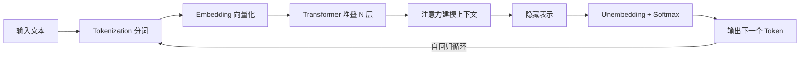
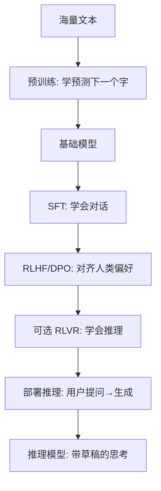

# 大语言模型概览：一个字一个字，怎么写出智能？

> **一句话：** LLM = 巨大参数 + 海量文本预训练的神经网络，核心本领是「预测下一个 token」；分词 → 向量化 → Transformer 堆叠 → 自回归循环，一条链路串起所有零件。

> 这是把前面几篇串起来的「总章」。你已经分别看了机器学习、神经网络、Transformer、注意力、训练——这篇用一个「从文字到智能」的完整链路，把它们黏合成一幅全景图。读完它，你应该能对着任意一个 LLM 说出「它由哪些零件、怎么造出来的」。

## 一句话定义

**大语言模型（LLM）**：一个参数量巨大（几十亿到上万亿）、在海量文本上预训练出来的神经网络，核心本领是「给定前面的文字，预测下一个最可能出现的字（token）」。聊天、写代码、翻译，都是这个本领的「外溢」。

---

## 从一句话到模型输出：全链路

下面逐个拆。

---

## 1. Tokenization：把文字切成「模型认识的词」

模型不直接吃字符，而是把文本切成 **token**（可以是字、词、或子词）。主流用 **BPE（Byte-Pair Encoding）** 算法：常见词整块保留，生僻词拆成小块，平衡「词表大小」和「覆盖度」。

::: tip 为什么这事影响钱
模型按 token 计费（输入 + 输出）。同样一句话，切得碎（token 多）就贵。中文通常比英文「更费 token」，这是做中文 AI 产品要留意的成本点。
:::

## 2. Embedding：把 token 变成「有含义的坐标」

每个 token 映射成一个高维向量（如 4096 维）。向量之间的距离 / 方向，编码了语义关系——「国王 - 男人 + 女人 ≈ 女王」这类经典现象就来自此。

## 3. Transformer 堆叠：核心计算

这些向量进入几十上百层 [Transformer](/knowledge/transformer)，每层都用 [注意力机制](/knowledge/attention) 让 token 之间交换信息、更新表示。层数越深，能捕捉的语义 / 逻辑越复杂。

## 4. 自回归生成：一个字一个字「吐」

模型最后用一层把隐藏表示映射回词表上的概率分布，采样出下一个 token；把这个 token 接回输入，循环下去，直到遇到「结束符」。

$$\text{输出分布} = \text{Softmax}(W_{out} \cdot h)$$

::: info 为什么叫「大」模型
参数量（Transformer 里那些 w、b）动辄几十亿到万亿。参数越多、数据越多，能力越强——这条经验规律叫 **Scaling Law（规模定律）**。但参数大也意味着 [注意力变体](/knowledge/attention) 和 [推理优化](/inference-optimization/) 变得至关重要，否则跑不起、跑不起。
:::

---

## 三个绕不开的指标 / 概念

- **上下文窗口（Context Window）**：模型「一次能同时看多长」的输入 + 输出长度。早期 2K token，现在主流 128K、甚至 1M+。窗口越长，[KV 缓存](/knowledge/attention) 越吃显存。
- **困惑度（Perplexity, PPL）**：衡量模型「预测准不准」的指标，越低越好。常用来比较预训练质量。
- **涌现能力（Emergence）**：模型小的时候某些能力没有，参数 / 数据过了一个阈值突然「冒出来」——这是大模型最迷人也最费解的特性之一。

---

## 完整生命周期：预训练 → 后训练 → 推理

把 [预训练与后训练](/knowledge/training) 和 [推理模型](/knowledge/reasoning) 的内容收进一张图：

> 到这里，你手里已经握住了理解任何一款现代大模型的「地图」。接下来就是按兴趣深入某个方向：做应用看 [Agent](/agent/)，抠效率看 [推理优化](/inference-optimization/)，比架构看 [模型架构](/architecture/)、[基础模型](/base-models/claude)。

---

## 下一步学什么

- **想做应用 / 产品**：看 [Agent 智能体](/agent/)——让模型调用工具、自己完成任务。
- **想抠成本与速度**：看 [推理优化](/inference-optimization/)——量化、蒸馏、KV 缓存优化。
- **想横向比各家**：看 [模型架构](/architecture/) 与 [基础模型](/base-models/claude)。

<!-- kb-related:start -->
## 相关笔记

- [注意力机制](/knowledge/attention) — 交叉引用
- [推理模型](/knowledge/reasoning) — 交叉引用
- [预训练与后训练](/knowledge/training) — 交叉引用
- [Transformer 架构](/knowledge/transformer) — 交叉引用
- [Claude](/base-models/claude) — 交叉引用

<!-- kb-related:end -->

<!-- kb-backlinks:start -->
## 被以下笔记引用

- [注意力机制](/knowledge/attention)
- [推理模型](/knowledge/reasoning)
- [预训练与后训练](/knowledge/training)
- [Transformer 架构](/knowledge/transformer)
- [Claude](/base-models/claude)
- [Agent 总览](/agent/)
- [模型架构总览](/architecture/)
- [推理优化总览](/inference-optimization/)

<!-- kb-backlinks:end -->

## 延伸阅读

- 李沐《动手学深度学习》中「自然语言处理：预训练」章（[zh.d2l.ai](https://zh.d2l.ai/)）
- Sebastian Raschka《Build a Large Language Model From Scratch》（从 tokenizer 到完整 LLM 手写实现）
- 本博客 [基础模型](/base-models/claude) / [模型架构](/architecture/) / [推理优化](/inference-optimization/) 栏目
