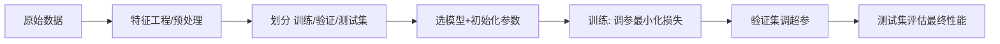
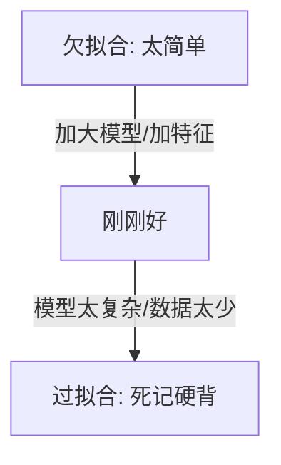

# 机器学习基础：机器怎么从数据里自己学出规则？

> **一句话：** 给计算机数据和目标，让它自己总结出规律——监督 / 无监督 / 强化三大范式，是后面一切模型的地基。

> 这是整套知识库的「地基」。如果把 AI 比作盖楼，这一篇讲的是「地桩和钢筋」——后面所有神经网络、大模型，本质上都是在这套框架上长出来的。

## 一句话理解机器学习

传统编程是「人写规则，计算机执行」：

```
规则：如果温度>30，就判断为「热」
输入：温度=35  → 输出：热
```

机器学习反过来，是「给数据，让计算机自己总结规则」：

```
输入：一堆「温度→冷热」的样例  → 模型自己学出规律  → 遇到新温度能判断
```

::: tip 核心差别
你不用把每一条规则写死，而是提供一个**目标**（比如「尽量预测准」）和**数据**，模型通过不断调整内部参数来逼近这个目标。这就是「学习」。
:::

---

## 三大学习范式

机器学习按「数据有没有标准答案」分成三类：

- **监督学习（Supervised Learning）**：每条数据都带「正确答案」（标签）。比如给一万张猫狗图，每张都标了「这是猫 / 这是狗」，模型学的是「输入 → 标签」的映射。
  - 典型任务：分类（是猫还是狗）、回归（房价预测、温度预测）。
  - 代表算法：线性回归、逻辑回归、决策树、SVM、神经网络。

- **无监督学习（Unsupervised Learning）**：数据没有标签，模型自己找结构。比如把一堆积压的客户数据，自动分成几类「长相相似」的群体。
  - 典型任务：聚类（K-Means）、降维（PCA）、异常检测。
  - 用途：用户分群、数据压缩、找异常。

- **强化学习（Reinforcement Learning）**：智能体在环境里「试错」，做对了给奖励、做错了给惩罚，目标是最大化长期累计奖励。
  - 典型场景：下棋（AlphaGo）、机器人控制、大模型的后训练（RLHF 就是它）。
  - 和大模型的关系：后面 [预训练与后训练](/knowledge/training) 里的 RLHF / RLVR 就建立在强化学习之上。

::: info 和大模型的关系
你现在用的 ChatGPT / Claude 这类大模型，主体走的是**监督学习（预训练 + SFT）打底，再用强化学习（RLHF / RLVR）精修**的路线。所以这篇基础篇是后面所有内容的前提。
:::

---

## 一次训练的标准流程

一个典型的监督学习任务，流程是这样的：



### 1. 数据划分：训练 / 验证 / 测试

- **训练集（Training Set）**：模型「上课」用的数据，参数靠它调整。
- **验证集（Validation Set）**：「模拟考」，用来调超参数（学习率、网络层数等），不参与最终评分。
- **测试集（Test Set）**：「高考」，模型从没见过，用来公平评估真实泛化能力。

::: warning 千万别用测试集调参
一旦拿测试集去调模型，等于「提前看了高考题」，测出来的分数就虚高了。测试集要像封卷一样，最后才打开。
:::

### 2. 损失函数（Loss）：给「错得多狠」打分

损失函数衡量「模型预测值和真实答案差多远」。差得越离谱，分数越高（惩罚越重）。

- 回归常用 **均方误差（MSE）**：

$$L = \frac{1}{n}\sum_{i=1}^{n}(y_i - \hat{y}_i)^2$$

- 分类常用 **交叉熵（Cross-Entropy）**，它惩罚「自信地答错」特别狠，逼模型别乱猜。

### 3. 梯度下降：沿着「最陡下坡」找最优

模型的目标是把损失降到最低。怎么降？想象你蒙眼下山，每步都朝「当前最陡的下坡方向」走一点——这个「方向」就是**梯度**（损失对参数的导数）。

::: tip 三个关键旋钮
- **学习率（Learning Rate）**：每步走多大。太大容易冲过谷底、震荡；太小走得慢、可能卡在半山腰。
- **批次大小（Batch Size）**：每次看多少样本才更新一次参数。
- **迭代轮数（Epoch）**：把所有训练数据过几遍。
:::

---

## 过拟合与正则化

这是新手最容易踩的坑。

- **欠拟合（Underfitting）**：模型太简单，连训练集都学不好——「没学会」。
- **过拟合（Overfitting）**：模型把训练集背得太死，换个新数据就翻车——「死记硬背，不会举一反三」。



**对抗过拟合的常见手段（正则化）**：

- **更多数据**：最根本的解药。
- **早停（Early Stopping）**：验证集指标不涨了就停，别硬训。
- ** dropout**：训练时随机「关掉」一部分神经元，强迫网络不依赖某几个特定节点。
- **权重衰减（L2 正则）**：惩罚过大的参数，让模型更「平滑」、更稳健。
- **数据增强**：对图片翻转 / 裁剪，对文本同义替换，人为造出更多样的数据。

---

## 常见评估指标

分类任务最常用的四个指标（以「预测是不是猫」为例）：

- **准确率（Accuracy）**：预测对的比例。但数据极度不平衡时（99% 都不是猫）会误导。
- **精确率（Precision）**：预测为猫的里面，真正是猫的比例（「宁漏勿错」场景看它）。
- **召回率（Recall）**：真正是猫的里面，被找出来的比例（「宁错勿漏」场景看它，如疾病筛查）。
- **F1 分数**：精确率和召回率的调和平均，综合权衡两者。

::: info 精确率 vs 召回率的权衡
提高阈值（更保守地判猫）会提高精确率但降低召回率，反之亦然。没有银弹，看业务场景更怕哪种错。
:::

---

## 下一步学什么

- 想动手跑通第一个模型：去 [全网优质学习资源](/roadmap/learning-resources) 选「李沐《动手学深度学习》」或「吴恩达 ML 专项」。
- 理解了「模型怎么学」，下一步看 [神经网络与反向传播](/knowledge/neural-networks)——看参数到底是怎么被「调」出来的。

<!-- kb-related:start -->
## 相关笔记

- [神经网络与反向传播](/knowledge/neural-networks) — 标签：梯度下降、交叉引用
- [预训练与后训练](/knowledge/training) — 交叉引用

<!-- kb-related:end -->

<!-- kb-backlinks:start -->
## 被以下笔记引用

- [神经网络与反向传播](/knowledge/neural-networks)
- [预训练与后训练](/knowledge/training)

<!-- kb-backlinks:end -->

## 延伸阅读

- 李沐《动手学深度学习》第三章（[zh.d2l.ai](https://zh.d2l.ai/)）
- 吴恩达《Machine Learning》专项（[deeplearning.ai](https://www.deeplearning.ai/specializations/machine-learning)）
- 3Blue1Brown《But what is a neural network?》（直觉入门，强烈推荐先看）
