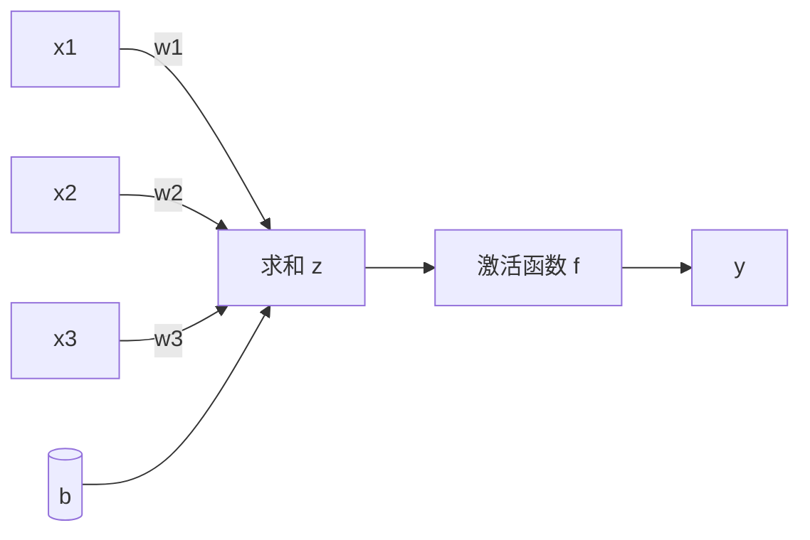
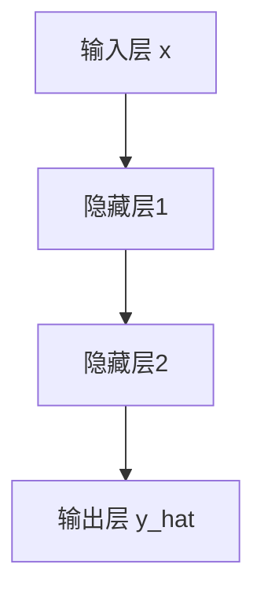
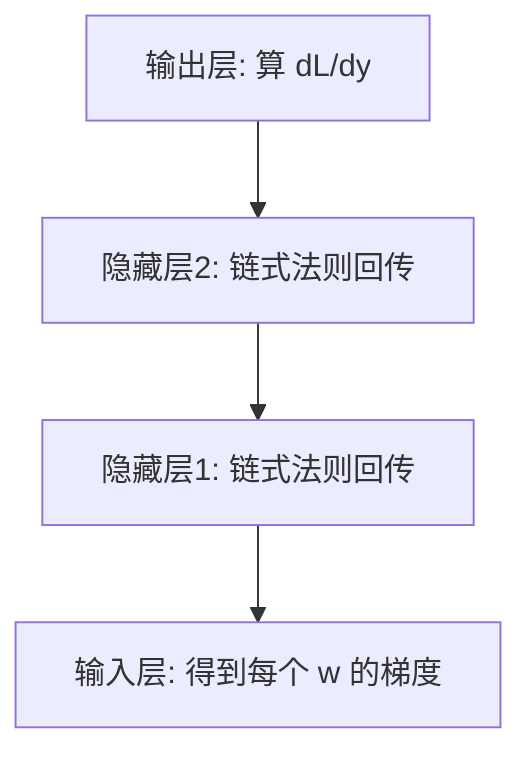

# 神经网络与反向传播：参数到底是怎么被调出来的？

> **一句话：** 神经元 = 加权求和 + 非线性激活，层层堆叠可逼近任意函数；反向传播用链式法则分摊误差，梯度下降照着梯度一步步调优。

> 上一篇讲了机器学习的「框架」，这篇钻进模型内部，看参数到底是怎么被「调」出来的。神经网络是现代所有大模型的最小积木，理解了它，再看 Transformer、LLM 就是「搭积木」。

## 从感知机说起

1943 年的「感知机」是最朴素的神经元：把几个输入加权求和，超过阈值就输出 1，否则 0。

$$output = \begin{cases} 1 & \text{if } \sum w_i x_i + b > 0 \\ 0 & \text{otherwise} \end{cases}$$

单个感知机只能学一条直线能分开的问题。但——**把很多个叠成多层，就能逼近任意复杂函数**。这就是神经网络的威力。

::: tip 为什么多层这么强
数学上有一个结论（万能近似定理）：只要神经元够多、层数够深，一个前馈网络可以逼近任何连续函数。所以「深」不是噱头，是能力来源。
:::

---

## 一个神经元长什么样

现代神经元和感知机类似，但多了两样东西：

- **加权求和**：`z = w₁x₁ + w₂x₂ + ... + b`（w 是权重，b 是偏置）
- **激活函数**：把 z 过一个非线性函数，再输出。

**关键在「非线性激活函数」**：如果只有加权求和（纯线性），叠多少层都等价于一层。加上非线性，深层网络才真正有了「表达能力」。

---

## 常见激活函数

- **Sigmoid**：把输出压到 (0,1)，像「概率」。缺点是两端梯度接近 0，深层网络容易「梯度消失」，现在不太用来做隐藏层。
- **Tanh**：压到 (-1,1)，比 Sigmoid 居中一些，同样有梯度消失问题。
- **ReLU（最常用）**：`f(x)=max(0,x)`，简单、计算快、不容易梯度消失。缺点是「死神经元」（输入为负就永远 0）。变体 Leaky ReLU / GELU 在 Transformer 里很常见。

::: info GELU 和 Transformer
你现在用的 LLM（GPT、Claude 等）几乎都用 **GELU** 或其变体作激活函数，它是 ReLU 的「平滑版」，在大模型上表现更好。
:::

---

## 前向传播：数据怎么「流」过去

「前向传播」就是：把输入一层层往上算，直到输出预测值。

每一层都做「加权求和 + 激活」。最终得到一个预测 `ŷ`，然后和真实 `y` 比，算出损失 L。到这里只是「正向跑了一遍」，还没「学」。

---

## 反向传播：模型怎么「改错」

这是整篇的核心。前向传播算出损失后，模型要回答一个问题：**「每个参数 w 该往哪调、调多少，才能让损失降下来？」**

答案是**链式法则（Chain Rule）**：损失 L 对某个权重 w 的梯度，等于「损失对输出的敏感度」×「输出对该权重的敏感度」，一层层往回乘。

::: tip 直觉版解释
想象你是个厨师，菜咸了（损失大）。你不会瞎改所有调料，而是想：「盐加多了多少？糖是不是也跟着多了？」——反向传播就是自动算出「每味调料对咸淡的贡献度（梯度）」，然后你按比例往反方向减一点（梯度下降）。
:::

**具体步骤**：
1. 前向传播算损失 L。
2. 反向传播，用链式法则算出 L 对**每一个**参数 w 的梯度 ∂L/∂w。
3. 梯度下降更新：`w ← w - η · ∂L/∂w`（η 是学习率）。
4. 重复 1–3，直到损失不再明显下降。

---

## 学习率：最该调的旋钮

反向传播告诉我们「往哪调」，学习率 η 决定「调多大步」。

- **太大**：在谷底附近来回横跳，甚至越训越糟。
- **太小**：走得极慢，可能卡在局部小坑里出不来。
- **实践技巧**：常用「学习率预热（warmup）+ 余弦退火（cosine decay）」——开头慢慢热身，中间大步，后期微调。大模型训练标配。

::: warning 梯度消失 / 爆炸
深层网络里，梯度一层层乘下来，可能小到趋近于 0（消失，前面层学不动）或大到爆掉（爆炸，训练发散）。这就是为什么 Transformer 要用 **LayerNorm + 残差连接**来稳住——后面 [Transformer 架构](/knowledge/transformer) 会细讲。
:::

---

## 下一步学什么

- 你已经懂了「单个模型怎么学」。但真正的大模型不是一堆乱叠的层，而是有精心设计的架构——看 [Transformer 架构](/knowledge/transformer)。
- 想真正手写一遍反向传播：强烈推荐 Karpathy《Zero to Hero》第 1–2 集（[karpathy.ai/zero-to-hero](https://karpathy.ai/zero-to-hero.html)），他会从零实现一个能识别数字的神经网络。

<!-- kb-related:start -->
## 相关笔记

- [机器学习基础](/knowledge/ml-basics) — 标签：梯度下降、交叉引用
- [Transformer 架构](/knowledge/transformer) — 交叉引用

<!-- kb-related:end -->

<!-- kb-backlinks:start -->
## 被以下笔记引用

- [机器学习基础](/knowledge/ml-basics)
- [Transformer 架构](/knowledge/transformer)

<!-- kb-backlinks:end -->

## 延伸阅读

- 3Blue1Brown《Neural Networks》系列（[YouTube](https://www.youtube.com/@3blue1brown)）——把反向传播讲成几何动画，必看。
- 李沐《动手学深度学习》相关章节（[zh.d2l.ai](https://zh.d2l.ai/)）
- Andrej Karpathy《Zero to Hero》（动手实现，化抽象为具体）
