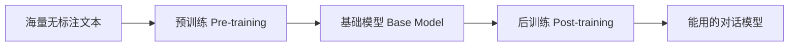
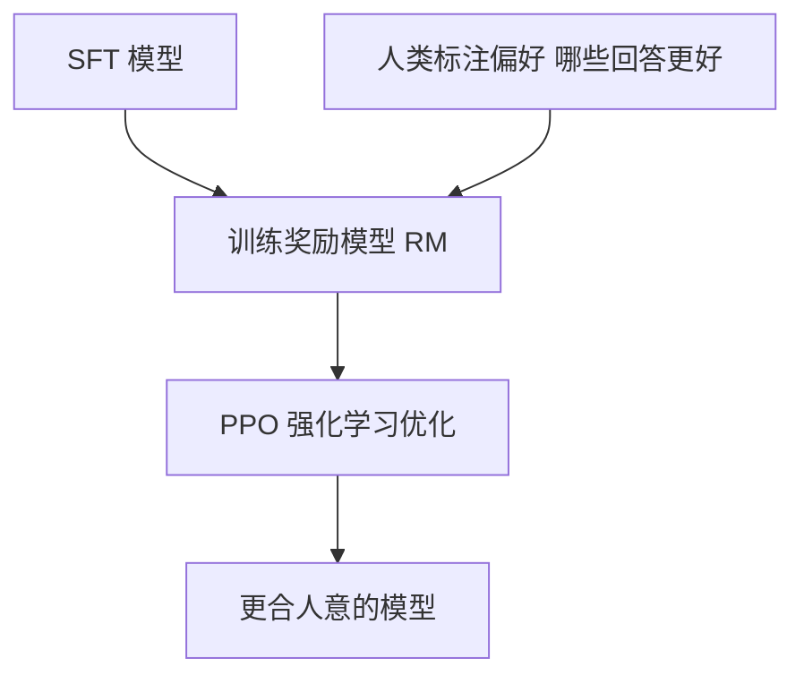

# 预训练与后训练：模型怎么从毛坯变成成品？

> **一句话：** 先海量文本自监督预训练出「博学但没规矩」的基础模型，再用 SFT → RLHF / DPO → RLVR 调教成听话、会思考的助手。

> 一个能聊天的大模型，不是「训一次」就成的，而是分阶段「打磨」出来的：先海量自学（预训练），再针对性调教（后训练）。这篇把这条流水线讲清楚，也是本博客 [后训练](/post-training/) 栏目的总纲。

## 两个阶段，两种目标

- **预训练**：给模型「博览群书」的能力。喂几千亿字的网页 / 书籍 / 代码，让它学会「预测下一个字」。这一步成本极高（几千张卡跑几个月），产出的是「基础模型」——它懂语言、懂知识，但不会乖乖对话。
- **后训练**：把基础模型「调教成好用的助手」。让它学会遵循指令、不胡说、按人类偏好作答。成本相对低，但决定了产品体验。

::: tip 一个贴切的比喻
预训练像「让一个人读完整个图书馆，脑子里装满知识和语感」；后训练像「送他去职场培训，学会怎么把知识用对地方、好好说话」。
:::

---

## 预训练：怎么「自学」

预训练用的是**自监督学习**——数据本身就有答案，不需要人工标注。两大目标：

- **CLM（因果语言建模，Causal LM）**：给前半句，预测下一个 token。GPT 系都用这个。因为要「预测未来」，所以注意力必须掩码（看不到后面的字）。
- **MLM（掩码语言建模，Masked LM）**：随机遮住句子里某些字，让模型猜被遮的是啥。BERT 用这个，适合「理解类」任务，但无法直接生成。

::: info 为什么是「预测下一个字」
这个看似简单的目标，逼着模型内化语法、事实、逻辑推理——因为要准确预测，它必须真的「理解」上下文。规模上去后，很多能力是「涌现」出来的，而不是显式教会的。
:::

---

## 后训练流水线（核心）

现代后训练通常分三步，层层递进：

### 第 1 步：SFT（监督微调，Supervised Fine-Tuning）

用「高质量问答对」教模型「该怎么回答」。比如人工或模型合成几十万条「用户问题 → 理想回答」，让模型模仿。

- 目标：让基础模型从「续写机器」变成「会对话的助手」。
- 本博客细讲：[SFT 监督微调](/post-training/sft)。

### 第 2 步：RLHF（基于人类反馈的强化学习）

SFT 后的模型还不一定「合人意」。RLHF 让**人类的偏好**来当老师：

1. **训练奖励模型（Reward Model）**：让标注员对同一个问题的多个回答排序（A 比 B 好），模型学会「给好回答打高分」。
2. **PPO 优化**：用强化学习（前面 [机器学习基础](/knowledge/ml-basics) 提过）让模型去「最大化奖励模型给的分」，同时用 KL 散度约束它别跑太偏。

- 难点：要训两个模型、流程复杂、容易不稳。
- 本博客细讲：[RLHF / DPO / RLVR](/post-training/rlhf-dpo)。

### 第 3 步（更优替代）：DPO（直接偏好优化）

DPO 发现：根本不用单独训奖励模型，也不用跑 PPO，只要用「偏好对」（一个好回答 + 一个差回答），直接在一个损失函数里把模型往「拉高好回答、压低差回答」的方向推。

$$\mathcal{L}_{DPO} = -\log\sigma\Big(\beta\log\frac{\pi_\theta(y_w|x)}{\pi_{ref}(y_w|x)} - \beta\log\frac{\pi_\theta(y_l|x)}{\pi_{ref}(y_l|x)}\Big)$$

::: tip DPO 为什么流行
把「训奖励模型 + 强化学习」两步合成一步，简单、稳、好复现。现在开源社区（Llama、Qwen 等）几乎都用 DPO 或其变体做偏好对齐。
:::

### 第 4 步（推理模型专属）：RLVR

针对「有标准答案」的任务（数学、代码），奖励不看「人类喜不喜欢」，而是看「答案对不对」（用 SymPy 验算、编译器跑测试）。这样模型为了拿奖励，会**自己学会打草稿、检查、纠错**——这是当下推理模型「会思考」的来源。详见 [推理模型](/knowledge/reasoning)。

---

## 一条经验主线

::: info 越往后，数据越「精」而非「多」
预训练靠量（万亿 token），后训练靠质（几万到几百万条精心构造的指令 / 偏好数据）。很多团队的后训练瓶颈不是算力，而是「造不出高质量数据」。
:::

---

## 下一步学什么

- 想看每一步的代码级细节：本博客 [后训练](/post-training/) 栏目的 SFT / RLHF-DPO 两篇。
- 想知道「会思考的模型」怎么炼：看 [推理模型](/knowledge/reasoning)。
- 把全链路串一遍：看 [大语言模型概览](/knowledge/llms)。

<!-- kb-related:start -->
## 相关笔记

- [后训练总览](/post-training/) — 标签：后训练、标签：SFT、标签：RLHF、标签：DPO、标签：RLVR、交叉引用
- [RLHF 与 DPO](/post-training/rlhf-dpo) — 标签：RLHF、标签：DPO、标签：RLVR、交叉引用
- [推理模型](/knowledge/reasoning) — 标签：RLVR、交叉引用
- [SFT 监督微调](/post-training/sft) — 标签：SFT、交叉引用
- [推理模型总览](/inference-models/) — 标签：RLVR、交叉引用

<!-- kb-related:end -->

<!-- kb-backlinks:start -->
## 被以下笔记引用

- [注意力机制](/knowledge/attention)
- [大语言模型概览](/knowledge/llms)
- [机器学习基础](/knowledge/ml-basics)
- [推理模型](/knowledge/reasoning)
- [Transformer 架构](/knowledge/transformer)
- [后训练总览](/post-training/)
- [RLHF 与 DPO](/post-training/rlhf-dpo)
- [SFT 监督微调](/post-training/sft)
- [推理模型总览](/inference-models/)

<!-- kb-backlinks:end -->

## 延伸阅读

- 本博客 [后训练](/post-training/) 栏目（SFT / RLHF / DPO 专篇）
- Sebastian Raschka《Build a Large Language Model From Scratch》（从预训练到 SFT 手写实现）
- 原论文：InstructGPT（RLHF 奠基）、DPO（Direct Preference Optimization, 2023）
