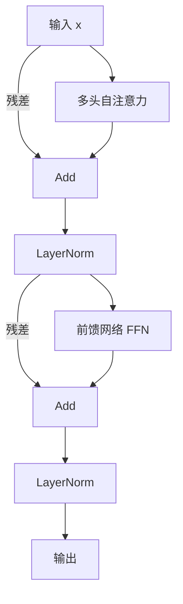

# Transformer 架构：为什么所有大模型都是同一副骨架？

> **一句话：** 让所有字同时互相看（自注意力），天然并行、不怕长句——编码器 + 解码器堆叠，就是今天所有 LLM 的统一底座。

> 2017 年 Google 论文《Attention Is All You Need》提出的 Transformer，是今天所有大模型的统一骨架。GPT、Claude、DeepSeek 再怎么花哨，底层都是它在「搭积木」。这篇先讲整体结构，注意力机制的细节留到 [注意力机制](/knowledge/attention) 单开一篇。

## 为什么需要 Transformer

在它之前，序列建模主要靠 **RNN / LSTM**：一句话要一个字一个字地「读」，第 N 个字的结果依赖第 N-1 个字。这带来两个致命问题：

- **无法并行**：必须串行处理，训练巨慢。
- **长程遗忘**：句子太长，开头的信息传到结尾就「淡忘」了。

Transformer 用**自注意力（Self-Attention）**彻底绕开这两点：一句话里所有字「同时」互相看，谁和谁相关一眼看穿，天然并行、不怕长句。

::: tip 一句话
RNN 像「逐字读书、边读边忘」；Transformer 像「把整页摊开、用荧光笔标出所有关联」——既快又全。
:::

---

## 整体结构：编码器 + 解码器

原始 Transformer 用于翻译，分两半：

- **编码器（Encoder）**：读懂「源语言」整句话，产出理解后的表示。
- **解码器（Decoder）**：基于这个表示，一个字一个字「生成」目标语言，且生成第 K 个字时只能看前 K-1 个字（用掩码保证不偷看未来）。

::: info 大模型只用了哪一半
GPT 这类「只生成」的模型只用**解码器**；BERT 这类「只理解」的模型只用**编码器**；翻译模型才两边都用。现在主流 LLM 都是「解码器-only」，所以下文重点讲解码器里的结构。
:::

---

## 解码器里的六大组件

不管编码器还是解码器，核心都是一个「层」，里面反复出现这几样：

### 1. 自注意力（Self-Attention）
让序列里每个位置都去「关注」其他所有位置，动态算出该给谁更多权重。这是 Transformer 的灵魂，详见 [注意力机制](/knowledge/attention)。

### 2. 多头注意力（Multi-Head Attention）
把注意力「分成好几组并行算」（比如 32 个头），每组关注不同角度的关系（有的看语法、有的看指代、有的看语义），最后拼起来。相当于「多个专家分别看，再汇总」。

### 3. 位置编码（Position Encoding）
注意力本身是「无序」的——它分不清「猫吃鱼」和「鱼吃猫」。所以要给每个字注入「你排第几」的位置信息。

- **绝对位置 / 正弦编码**：原始论文用固定正弦曲线编码位置。
- **RoPE（旋转位置编码）**：现在大模型主流，把位置信息「旋转」进向量里，对长文本外推更友好。详见 [注意力机制](/knowledge/attention) 末尾。

### 4. 前馈网络（FFN, Feed-Forward Network）
每个位置各自过一个小两层全连接网络（升维再降维）。注意力负责「看全局关系」，FFN 负责「逐位置加工」。

### 5. 层归一化（LayerNorm）
把每层输出「标准化」一下（均值 0、方差 1），稳住训练、防止数值跑飞。前面 [神经网络](/knowledge/neural-networks) 提过梯度消失，LayerNorm 是缓解它的关键手段之一。

### 6. 残差连接（Residual / Skip Connection）
每层输入「抄一条近路」直接加到输出上：`输出 = 层(输入) + 输入`。这样即使某一层没学好，信息也能原样流过，深层网络才训得动。

> 上面这张图就是一个「解码器层」的内部。实际模型会**把这样的层堆几十上百层**（比如 GPT-3 有 96 层），层数越深，表达能力越强。

---

## 为什么 Transformer 这么强

- **并行训练**：所有位置同时算注意力，GPU 利用率拉满，能喂海量数据。
- **长程依赖**：任意两字直接相连，不靠一步步传递，长文本关系不丢失。
- **可扩展**：堆层、堆参数、堆数据，性能基本随规模稳定提升（这就是「Scaling Law」的现实基础）。

::: warning 代价：算力与显存
注意力对长度的复杂度是 **O(n²)**（n 是序列长度）——句子翻倍，计算量翻四倍。这也是为什么后面要搞各种注意力变体（GQA、MLA、滑动窗口、线性注意力）来省资源，详见 [注意力机制](/knowledge/attention) 和 [推理优化](/inference-optimization/)。
:::

---

## 下一步学什么

- 注意力是 Transformer 的灵魂，还没讲透——看 [注意力机制](/knowledge/attention)：Q/K/V、缩放点积公式、KV 缓存、各种变体。
- 想知道模型「从毛坯到成品」怎么炼：看 [预训练与后训练](/knowledge/training)。

<!-- kb-related:start -->
## 相关笔记

- [模型架构总览](/architecture/) — 标签：位置编码、交叉引用
- [注意力机制](/knowledge/attention) — 交叉引用
- [大语言模型概览](/knowledge/llms) — 交叉引用
- [神经网络与反向传播](/knowledge/neural-networks) — 交叉引用
- [预训练与后训练](/knowledge/training) — 交叉引用

<!-- kb-related:end -->

<!-- kb-backlinks:start -->
## 被以下笔记引用

- [注意力机制](/knowledge/attention)
- [大语言模型概览](/knowledge/llms)
- [神经网络与反向传播](/knowledge/neural-networks)
- [预训练与后训练](/knowledge/training)
- [模型架构总览](/architecture/)
- [推理优化总览](/inference-optimization/)

<!-- kb-backlinks:end -->

## 延伸阅读

- 原论文《Attention Is All You Need》（2017，arXiv:1706.03762）
- 李沐《动手学深度学习》Transformer 章节（[zh.d2l.ai](https://zh.d2l.ai/)）
- Jay Alammar《The Illustrated Transformer》（图文并茂，必看）
- 想看真实架构对比：本博客 [模型架构](/architecture/) 栏目
